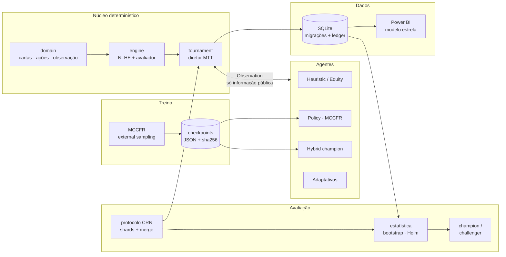
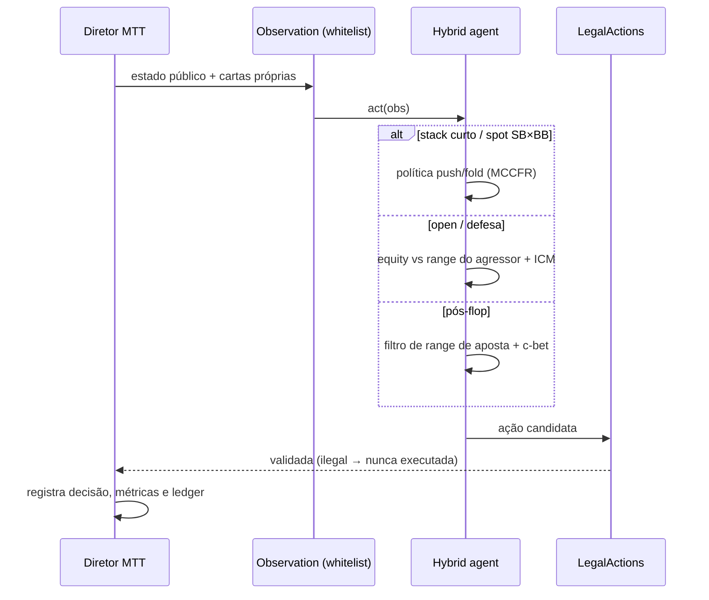
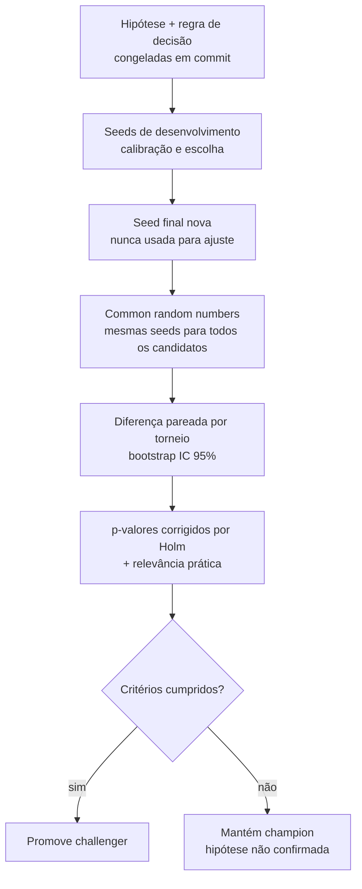
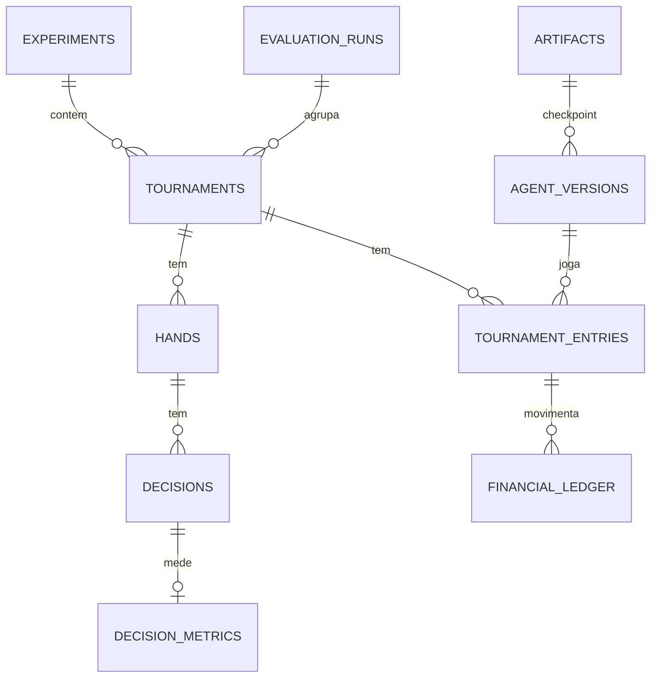

<div align="center">

# ♠ Poker AI Tournament Lab

**Laboratório de pesquisa em agentes para No-Limit Hold'em 6-max: simulador de torneios MTT, MCCFR, avaliação estatística pareada e analytics para Power BI.**


[Visão geral](#visão-geral) · [Resultados](#resultados) · [Arquitetura](#arquitetura) · [Metodologia](#metodologia-de-avaliação) · [Como rodar](#como-rodar) · [Roadmap](#roadmap)

</div>

> [!IMPORTANT]
> Tudo roda em um **simulador local**, em unidades simuladas (SIM). Nenhum resultado aqui é evidência de lucro com dinheiro real. Não há integração com salas de poker com dinheiro real nem automação de interface gráfica ([`docs/EXECUTION_LAYER.md`](docs/EXECUTION_LAYER.md)).

---

## Visão geral

O projeto responde a uma pergunta de engenharia: **como construir, treinar e comparar agentes de poker de forma reprodutível, sem se enganar com variância?**

| Camada | O que existe |
|---|---|
| **Motor de jogo** | NLHE próprio: side pots, all-in curto que não reabre a ação, antes, odd chip. O avaliador de mãos é validado contra a `treys` |
| **Torneios** | Diretor MTT com múltiplas mesas, blinds crescentes, balanceamento, reentrada e premiação configurável |
| **Agentes** | Random, Heuristic (perfis TAG/LAG/nit/station), Equity (Monte Carlo + ICM), Policy (MCCFR), **Hybrid** (champion) e oponentes adaptativos |
| **Treino** | MCCFR com *external sampling*, melhor resposta exata, abstração push/fold com antes e dead money, checkpoints com sha256 |
| **Avaliação** | Common random numbers, bootstrap, correção de Holm, regra champion/challenger **pré-registrada** e seeds separadas para desenvolvimento e avaliação final |
| **Dados** | SQLite com migrações versionadas, backup verificado, ledger financeiro conciliado e métricas por decisão |
| **Analytics** | Modelo estrela para Power BI, medidas DAX e intervalos de confiança pré-calculados |

---

## Resultados

Os números abaixo vêm da **avaliação final da P7b** (seed raiz 20261028, nunca usada para ajuste). Os gráficos são gerados por [`scripts/make_readme_charts.py`](scripts/make_readme_charts.py) a partir de [`docs/p7b_artifacts/p7b_final_report.json`](docs/p7b_artifacts/p7b_final_report.json); nenhum valor foi digitado à mão.

### ROI por agente no cenário principal

<picture>
  <source media="(prefers-color-scheme: dark)" srcset="docs/assets/roi_baseline_dark.png">
  
</picture>

Torneios de 12 jogadores com buy-in de 100 + taxa de 10. Com habilidade igual, o ROI esperado é **−9,1%**, só por causa da taxa (linha tracejada).

### Diferença pareada: champion × baseline anterior

<picture>
  <source media="(prefers-color-scheme: dark)" srcset="docs/assets/paired_by_scenario_dark.png">
  
</picture>

Cada torneio do `hybrid-v1` é comparado com o torneio do baseline jogado com **as mesmas seeds** (cartas e campo idênticos). Isso remove a maior parte da variância de cartas.

| Decisão (regra pré-registrada) | Estimativa | IC 95% | p (Holm) | Resultado |
|---|---|---|---|---|
| `hybrid-v1` vs `push/fold P7`, cenário principal (n = 400) | **+0,998** buy-in/torneio | [0,742; 1,249] | 0,0015 | **promovido a champion** |
| `hybrid-v1` vs perfil LAG de referência | +0,20 | [−0,08; 0,51] | — | inconclusivo (≠ equivalência) |

### Validação do MCCFR

<picture>
  <source media="(prefers-color-scheme: dark)" srcset="docs/assets/mccfr_convergence_dark.png">
  
</picture>

- **Kuhn poker:** o valor do jogo converge para o teórico −1/18 ≈ −0,0556 (observado −0,0555), e as frequências seguem a estrutura de equilíbrio conhecida (ex.: aposta com K ≈ 3α).
- **Push/fold heads-up com 10 bb:**
  - exploitability de **0,0053 bb/mão**, medida por melhor resposta exata;
  - ranges com Jaccard de **0,92** (push) e **0,95** (call) em relação a uma tabela publicada de Nash ([`docs/TRAINING.md`](docs/TRAINING.md)).

---

## Arquitetura



### Uma decisão do agente



**Garantias de projeto**
- Os agentes só recebem uma `Observation` montada por **whitelist**: cartas de adversários e cartas futuras nunca chegam a eles. Há testes de invariância que trocam as cartas ocultas e verificam que a decisão não muda.
- O motor é a fonte da verdade: nenhuma ação ilegal é executada, e toda decisão fica registrada com seu contexto.
- O ledger de cada torneio é conciliado (buy-ins, taxas, prêmios). Um torneio que não fecha falha alto.

---

## Metodologia de avaliação



- **Pareamento (CRN):** cada candidato joga exatamente os mesmos torneios (cartas e campo), e a unidade de randomização é o torneio.
- **Incerteza:** bootstrap por percentil (com cluster quando necessário), p-valores por bootstrap sob a hipótese nula deslocada e correção de Holm para múltiplos cenários.
- **Inconclusivo ≠ equivalente:** um intervalo que contém zero não é tratado como "empate".
- **Regra pré-registrada:** IC primário > 0, Holm p < 0,05, nenhum cenário com IC inteiramente negativo e zero ações inválidas.
- **Integridade:** shards retomáveis, merge idempotente, verificação de completude e pareamento, e incidentes operacionais documentados com os dados preservados.

Detalhes em [`docs/EVALUATION_PROTOCOL.md`](docs/EVALUATION_PROTOCOL.md) e [`docs/FINANCIAL_METRICS.md`](docs/FINANCIAL_METRICS.md).

---

## Modelo de dados



As migrações são versionadas ([`docs/MIGRATIONS.md`](docs/MIGRATIONS.md)) e cada uma é aplicada com backup verificado e restauração automática em caso de falha. A view `v_entry_financials` alimenta ROI, ITM e drawdown no Power BI ([`powerbi/`](powerbi/)).

---

## Estrutura do projeto

```text
src/poker_lab/
├── domain/        cartas, ações, observação (whitelist), seeds
├── engine/        avaliador de mãos e motor NLHE (fonte da verdade)
├── agents/        random, heuristic, equity, policy, hybrid, adaptive, registry
├── strategy/      equity Monte Carlo, ranges, pot odds/EV/SPR, ICM, modelo de oponentes
├── tournament/    diretor MTT (mesas, blinds, balanceamento, reentradas, premiação)
├── training/      MCCFR, Kuhn, push/fold HU, checkpoints
├── evaluation/    protocolo, estatística, champion/challenger, relatório
├── persistence/   SQLite, migrações, backup, retenção
├── analytics/     all-in EV, métricas de decisão
└── application/   casos de uso (mão, torneio, treino)
scripts/           treino, avaliações P7/P7b/P7c, auditorias, gráficos
tests/             unit · engine · property (Hypothesis) · agents · tournament · integration
docs/              relatórios por fase, protocolo, regras, versões de modelo
powerbi/           especificação do modelo semântico e medidas DAX
```

---

## Como rodar

**Windows**
```bat
setup.bat              :: cria .venv e instala dependências
run_tests.bat          :: suíte completa
run_demo.bat           :: MTT de 12 jogadores -> artifacts\demo.db
```

**Linux / macOS**
```bash
python3.12 -m venv .venv && source .venv/bin/activate
pip install -r requirements-dev.txt && pip install -e . --no-deps
python -m pytest                      # testes
python scripts/demo.py                # torneio de demonstração
python scripts/make_readme_charts.py  # regenera os gráficos deste README (requer matplotlib)
```

> Os checkpoints e os bancos de resultados ficam em `artifacts/`, que não é versionado por causa do tamanho. As versões de modelo, os hashes e as premissas de treino estão em [`docs/MODEL_VERSIONS.md`](docs/MODEL_VERSIONS.md).

---

## Roadmap

| Fase | Escopo | Status |
|---|---|---|
| P0 | Inspeção, arquitetura e contratos | ✅ |
| P1–P3 | Motor NLHE, avaliador, agentes base | ✅ |
| P4 | Diretor MTT multi-mesa | ✅ |
| P5–P6 | MCCFR, push/fold, persistência e analytics | ✅ |
| P7 | Avaliação quantitativa (~5.900 torneios) e métricas financeiras | ✅ |
| P7b | Diagnóstico, melhorias e promoção do `hybrid-v1` | ✅ |
| P7c | Robustez: oponentes adaptativos, blefadores, self-play | 🔄 em análise |
| P8 | Dashboard Power BI (especificação pronta) | ⏳ |
| P9–P10 | CLI/API/UI e otimização | ⏳ |
| P11 | Adaptador experimental para plataforma de bots com fichas virtuais (branch `p11-openpoker`) | 🧪 testado localmente |

---

## Documentação

| Documento | Conteúdo |
|---|---|
| [`P0_REPORT.md`](docs/P0_REPORT.md) | Inspeção inicial, arquitetura e contratos |
| [`P7_REPORT.md`](docs/P7_REPORT.md) · [`P7B_REPORT.md`](docs/P7B_REPORT.md) | Resultados, limitações e conclusões permitidas |
| [`MODEL_VERSIONS.md`](docs/MODEL_VERSIONS.md) | Registro imutável de versões, sha256 e premissas |
| [`STRATEGY_GUARANTEES.md`](docs/STRATEGY_GUARANTEES.md) | O que é heurístico e o que tem garantia teórica |
| [`TRAINING.md`](docs/TRAINING.md) | Auditoria do MCCFR e da política push/fold |
| [`ENGINE_RULES.md`](docs/ENGINE_RULES.md) · [`TOURNAMENT_RULES.md`](docs/TOURNAMENT_RULES.md) | Regras implementadas |

---

## Limitações

- Os resultados valem **contra os campos simulados testados**; não se generalizam para jogadores humanos nem para outros bots.
- O pós-flop do `hybrid-v1` é heurístico. Só a parte push/fold tem garantia de proximidade de equilíbrio (heads-up, abstração de stack).
- Um IC que contém zero é **inconclusivo**, não "sem diferença".

## Licença

MIT. A biblioteca `treys` (MIT) é usada **apenas nos testes**, para validar o avaliador de mãos.
