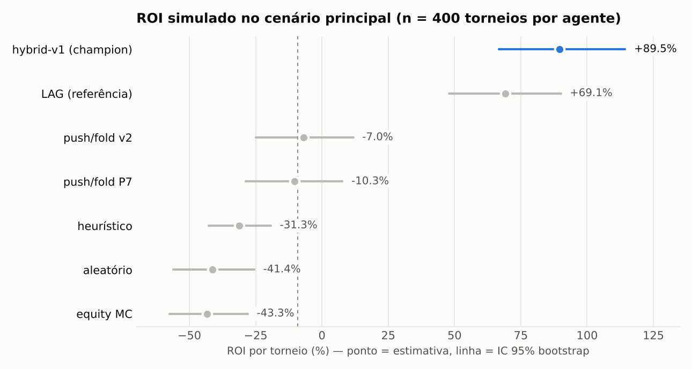
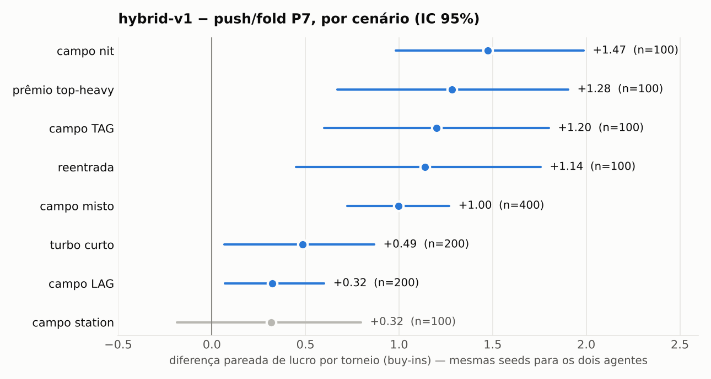
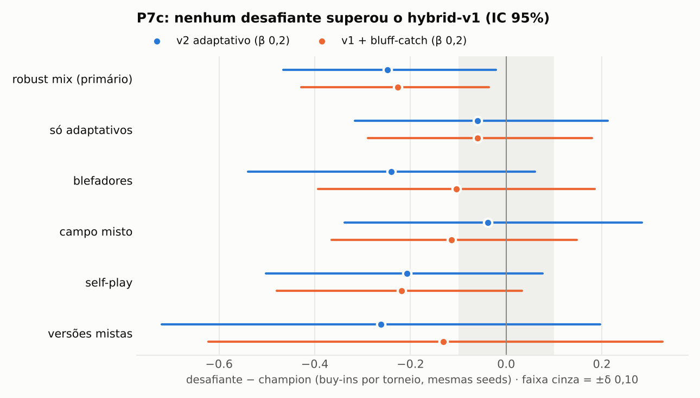
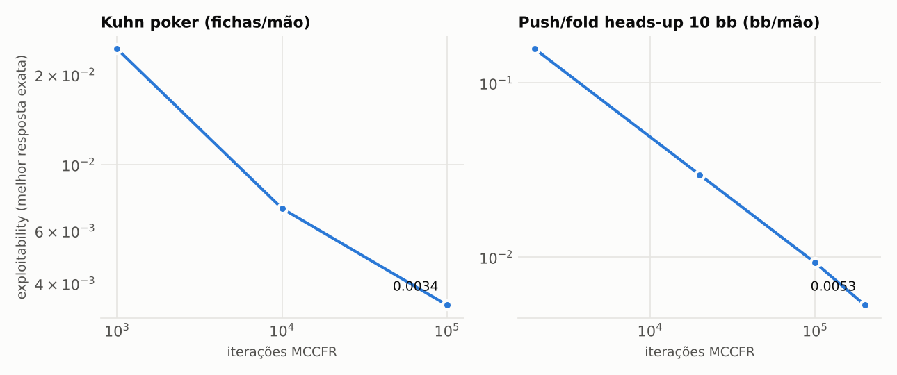
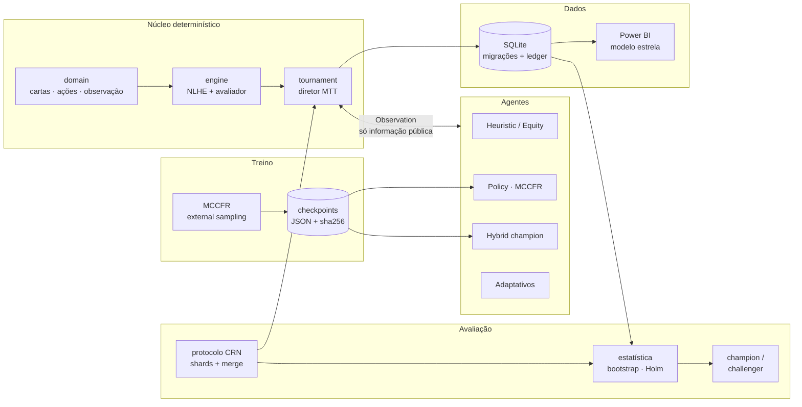
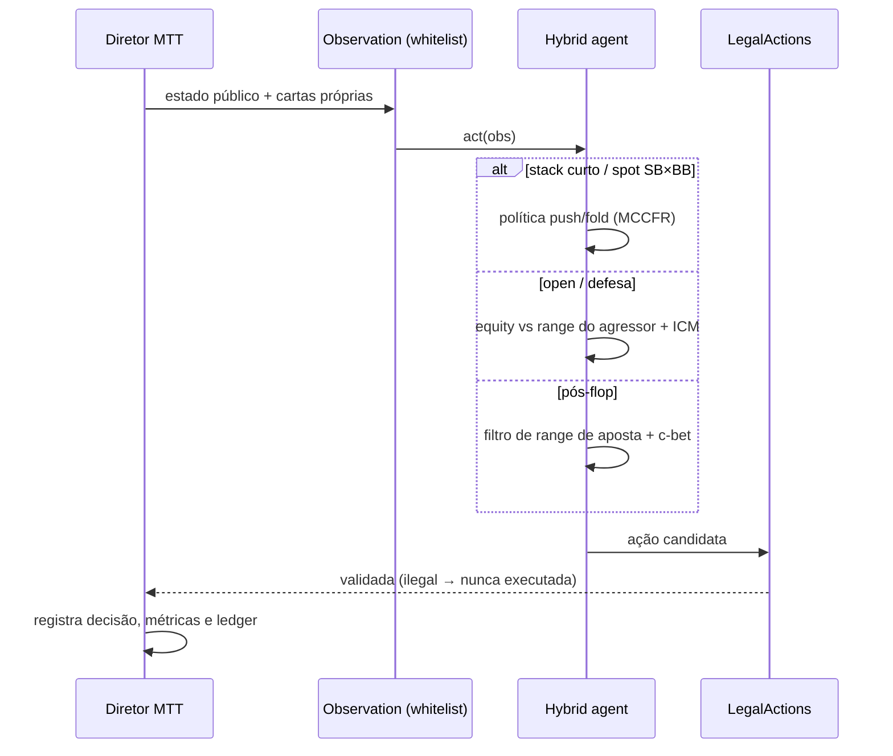
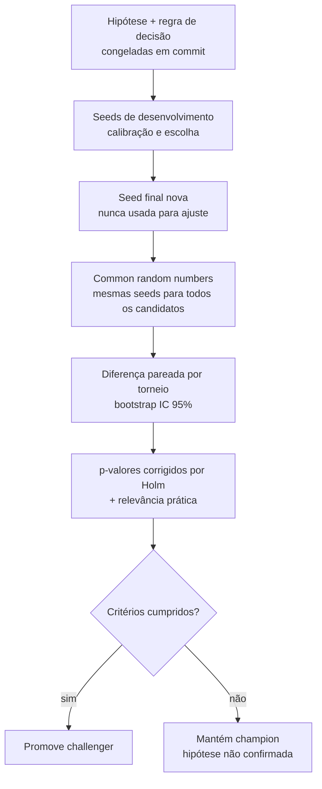
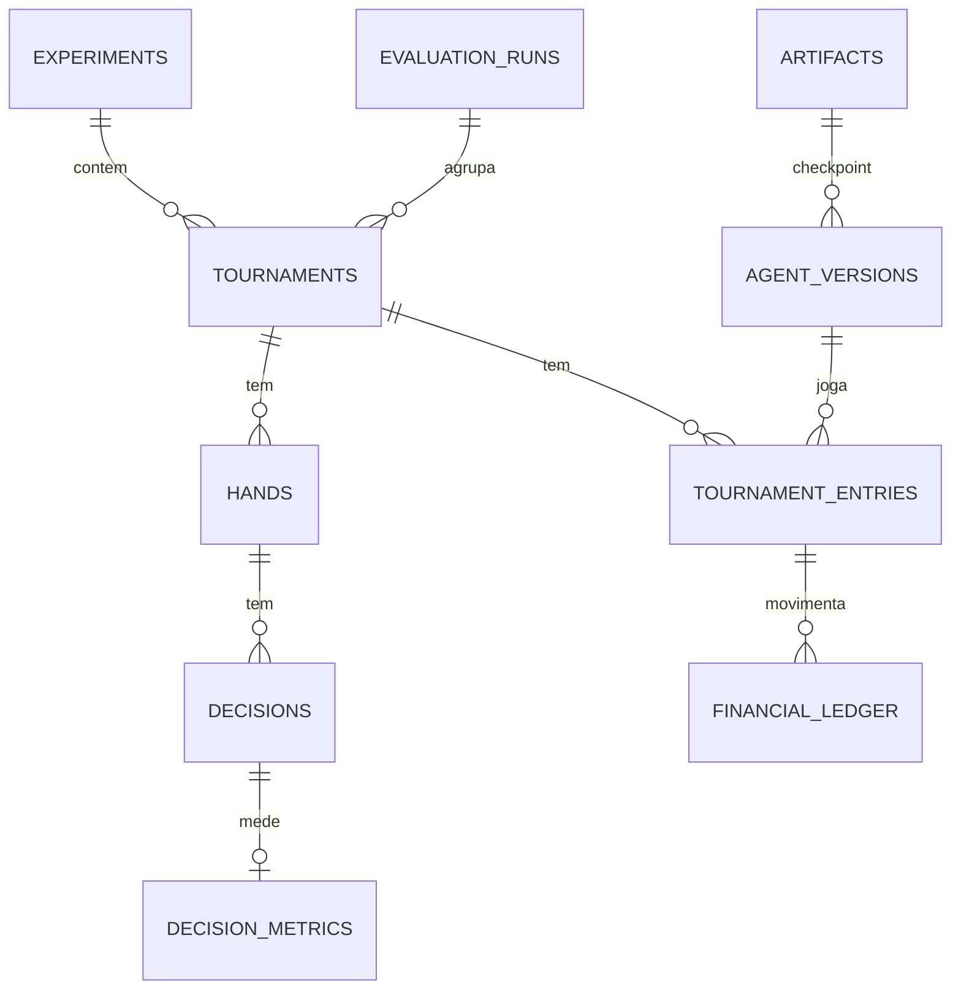
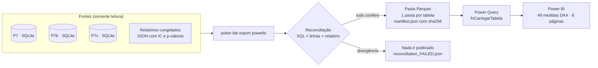
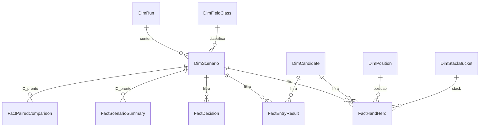

<div align="center">

# ♠ Poker AI Tournament Lab

**Laboratório de pesquisa em agentes para No-Limit Hold'em 6-max: simulador de torneios MTT, MCCFR, avaliação estatística pareada e analytics para Power BI.**


[**Como usar (passo a passo)**](docs/COMO_USAR.md) · [Visão geral](#visão-geral) · [Resultados](#resultados) · [Arquitetura](#arquitetura) · [Metodologia](#metodologia-de-avaliação) · [Power BI](#analytics-e-power-bi) · [Como rodar](#como-rodar) · [Roadmap](#roadmap)

</div>

> [!IMPORTANT]
> Tudo roda em um **simulador local**, em unidades simuladas (SIM). Nenhum resultado aqui é evidência de lucro com dinheiro real. Não há integração com salas de poker com dinheiro real nem automação de interface gráfica ([`docs/EXECUTION_LAYER.md`](docs/EXECUTION_LAYER.md)).

---

## Em números

| | |
|---|---|
| **21.000** torneios avaliados | P7 (5.900) · P7b (9.100) · P7c (6.000), todos com seeds fixas e reproduzíveis |
| **`hybrid-v1`** é o champion | promovido na P7b (+0,998 buy-in/torneio, p Holm 0,0015) e mantido na P7c |
| **983** verificações de reconciliação | entre banco, exportação e relatório, com **0** divergências |
| **254** testes | motor, agentes (incluindo invariância a cartas ocultas), MCCFR, estatística, migrações, exportação, aplicação local, controle de sessão (pausa/emergência/concorrência) e controle de qualidade |
| **0** ações inválidas | em todas as avaliações finais |

## Visão geral

O projeto responde a uma pergunta de engenharia: **como construir, treinar e comparar agentes de poker de forma reprodutível, sem se enganar com variância?**

| Camada | O que existe |
|---|---|
| **Motor de jogo** | NLHE próprio: side pots, all-in curto que não reabre a ação, antes, odd chip. O avaliador de mãos é validado contra a `treys` |
| **Torneios** | Diretor MTT com múltiplas mesas, blinds crescentes, balanceamento, reentrada e premiação configurável |
| **Agentes** | Random, Heuristic (perfis TAG/LAG/nit/station), Equity (Monte Carlo + ICM), Policy (MCCFR), **Hybrid** (champion) e oponentes adaptativos |
| **Treino** | MCCFR com *external sampling*, melhor resposta exata, abstração push/fold com antes e dead money, checkpoints com sha256 |
| **Avaliação** | Common random numbers, bootstrap, correção de Holm, regra champion/challenger **pré-registrada** e seeds separadas para desenvolvimento e avaliação final |
| **Dados** | SQLite com migrações versionadas, backup verificado, ledger financeiro conciliado e métricas por decisão |
| **Analytics** | Exportação para Power BI em modelo estrela (Parquet), reconciliada contra banco e relatórios, com 49 medidas DAX, Power Query, tema e guia de montagem |

---

## Resultados

Os números abaixo vêm das **avaliações finais da P7b** (seed raiz 20261028) **e da P7c** (seed 20261029). Nenhuma das duas seeds foi usada para ajuste. Os gráficos são gerados por [`scripts/make_readme_charts.py`](scripts/make_readme_charts.py) a partir dos relatórios versionados em `docs/p7b_artifacts/` e `docs/p7c_artifacts/`; nenhum valor foi digitado à mão.

### ROI por agente no cenário principal

<picture>
  <source media="(prefers-color-scheme: dark)" srcset="docs/assets/roi_baseline_dark.png">
  
</picture>

Torneios de 12 jogadores com buy-in de 100 + taxa de 10. Com habilidade igual, o ROI esperado é **−9,1%**, só por causa da taxa (linha tracejada).

### Diferença pareada: champion × baseline anterior

<picture>
  <source media="(prefers-color-scheme: dark)" srcset="docs/assets/paired_by_scenario_dark.png">
  
</picture>

Cada torneio do `hybrid-v1` é comparado com o torneio do baseline jogado com **as mesmas seeds** (cartas e campo idênticos). Isso remove a maior parte da variância de cartas.

| Decisão (regra pré-registrada) | Estimativa | IC 95% | p (Holm) | Resultado |
|---|---|---|---|---|
| `hybrid-v1` vs `push/fold P7`, cenário principal (n = 400) | **+0,998** buy-in/torneio | [0,742; 1,249] | 0,0015 | **promovido a champion** |
| `hybrid-v1` vs perfil LAG de referência | +0,20 | [−0,08; 0,51] | — | inconclusivo (≠ equivalência) |

### Robustez (P7c): o champion se sustenta

<picture>
  <source media="(prefers-color-scheme: dark)" srcset="docs/assets/p7c_challengers_dark.png">
  
</picture>

O ciclo de robustez enfrentou dois desafiantes ao `hybrid-v1` em seis cenários: oponentes adaptativos, blefadores, self-play e campos mistos, com 6.000 torneios, seed final nova e a regra congelada antes da execução.
- **Nenhum desafiante teve estimativa positiva em nenhum cenário**, e o champion foi **mantido**.
- No cenário primário, as duas variantes pioraram de 0,22 a 0,25 buy-in por torneio, mas essa piora não sobrevive à correção de Holm.
- Os steals do champion **continuam lucrativos contra defensores adaptativos**: +1,25 bb por steal, IC [1,04; 1,47].
- O ponto fraco identificado é o campo de blefadores, onde o ROI fica perto de zero e inconclusivo.

Detalhes em [`docs/P7C_REPORT.md`](docs/P7C_REPORT.md).

### Validação do MCCFR

<picture>
  <source media="(prefers-color-scheme: dark)" srcset="docs/assets/mccfr_convergence_dark.png">
  
</picture>

- **Kuhn poker:** o valor do jogo converge para o teórico −1/18 ≈ −0,0556 (observado −0,0555), e as frequências seguem a estrutura de equilíbrio conhecida (ex.: aposta com K ≈ 3α).
- **Push/fold heads-up com 10 bb:**
  - exploitability de **0,0053 bb/mão**, medida por melhor resposta exata;
  - ranges com Jaccard de **0,92** (push) e **0,95** (call) em relação a uma tabela publicada de Nash ([`docs/TRAINING.md`](docs/TRAINING.md)).

---

## Arquitetura



### Uma decisão do agente



**Garantias de projeto**
- Os agentes só recebem uma `Observation` montada por **whitelist**: cartas de adversários e cartas futuras nunca chegam a eles. Há testes de invariância que trocam as cartas ocultas e verificam que a decisão não muda.
- O motor é a fonte da verdade: nenhuma ação ilegal é executada, e toda decisão fica registrada com seu contexto.
- O ledger de cada torneio é conciliado (buy-ins, taxas, prêmios). Um torneio que não fecha falha alto.

---

## Metodologia de avaliação



- **Pareamento (CRN):** cada candidato joga exatamente os mesmos torneios (cartas e campo), e a unidade de randomização é o torneio.
- **Incerteza:** bootstrap por percentil (com cluster quando necessário), p-valores por bootstrap sob a hipótese nula deslocada e correção de Holm para múltiplos cenários.
- **Inconclusivo ≠ equivalente:** um intervalo que contém zero não é tratado como "empate".
- **Regra pré-registrada:** IC primário > 0, Holm p < 0,05, nenhum cenário com IC inteiramente negativo e zero ações inválidas.
- **Integridade:** shards retomáveis, merge idempotente, verificação de completude e pareamento, e incidentes operacionais documentados com os dados preservados.

Detalhes em [`docs/EVALUATION_PROTOCOL.md`](docs/EVALUATION_PROTOCOL.md) e [`docs/FINANCIAL_METRICS.md`](docs/FINANCIAL_METRICS.md).

---

## Modelo de dados



As migrações são versionadas ([`docs/MIGRATIONS.md`](docs/MIGRATIONS.md)) e cada uma é aplicada com backup verificado e restauração automática em caso de falha. A view `v_entry_financials` é a base de ROI, ITM e drawdown.

---

## Analytics e Power BI





- **Classe do campo:** cada cenário é classificado pela composição real dos oponentes. As classes são explorável, agressivo/blefador, adaptativo, self-play ou misto. Isso permite separar "ganha de campos fracos" de "resiste a adversários fortes".
- **Estatística pronta:** intervalos de confiança, p-valores e decisões vêm dos relatórios congelados. O DAX só filtra e exibe, e as medidas de IC ficam vazias fora de um contexto de 1 cenário × 1 agente.
- **Privacidade da informação:** a tabela de decisões só tem o que o herói via. Não há cartas de adversários nem board; há teste para isso.
- **8 páginas:**
  1. Resumo executivo;
  2. Campo explorável × agressivo/adaptativo;
  3. Champion × desafiante;
  4. Posição e stack;
  5. Decisões;
  6. Variância e sorte;
  7. Steal;
  8. Versões e auditoria.

Montagem passo a passo, com os valores esperados para conferência, em [`powerbi/GUIA_MONTAGEM_P8.md`](powerbi/GUIA_MONTAGEM_P8.md).

---

## Estrutura do projeto

```text
src/poker_lab/
├── domain/        cartas, ações, observação (whitelist), seeds
├── engine/        avaliador de mãos e motor NLHE (fonte da verdade)
├── agents/        random, heuristic, equity, policy, hybrid, adaptive, registry
├── strategy/      equity Monte Carlo, ranges, pot odds/EV/SPR, ICM, modelo de oponentes
├── tournament/    diretor MTT (mesas, blinds, balanceamento, reentradas, premiação)
├── training/      MCCFR, Kuhn, push/fold HU, checkpoints
├── evaluation/    protocolo, estatística, champion/challenger, relatório
├── persistence/   SQLite, migrações, backup, retenção
├── analytics/     all-in EV, métricas de decisão, exportação Power BI reconciliada
├── application/   casos de uso (mão, torneio, treino)
├── lab/           camada operacional: verificações somente leitura, artefatos congelados, configuração
├── api/           servidor local (127.0.0.1) e interface no navegador
└── cli.py         comando `poker-lab` (info, ui, runs, verify, config, export)
scripts/           treino, avaliações P7/P7b/P7c, integridade, recuperação, tabelas e gráficos
tests/             unit · engine · property (Hypothesis) · agents · tournament · integration
docs/              guia de uso, relatórios por fase, protocolo, regras, versões de modelo
powerbi/           Power Query, medidas DAX, tema, especificação e guia de montagem
artifacts/         checkpoints e tabelas de equity versionados; bancos e exportações gerados (fora do Git)
```

---

## Como rodar

> **Guia completo, passo a passo:** [`docs/COMO_USAR.md`](docs/COMO_USAR.md). Ele cobre instalação, testes, reprodução das avaliações, verificação de integridade, como analisar os resultados e o Power BI.

**Aplicação (interface no navegador):** dê dois cliques em `iniciar_lab.bat` (no PowerShell: `.\iniciar_lab.bat`) (Linux/macOS: `./iniciar_lab.sh`). O servidor roda só nesta máquina (127.0.0.1) com código de acesso por sessão. As telas são Início, **Simulação** (sessão autônoma local com Pausar, Retomar, Encerrar e Parada de emergência, controle de qualidade estatístico e resultados ao vivo), **Sessões** (histórico mão a mão), Histórico, Análise, Configurar e Verificar. A sessão online continua desativada.

**Windows**
```bat
setup.bat                 :: cria .venv e instala dependências
iniciar_lab.bat           :: abre a interface local no navegador
run_tests.bat             :: suíte completa (254 testes)
run_demo.bat              :: MTT de 12 jogadores -> artifacts\demo.db
run_p7c_evaluation.bat    :: avaliação de robustez completa (6.000 torneios)
run_powerbi_export.bat    :: exportação reconciliada para o Power BI
```

**Linux / macOS**
```bash
python3.12 -m venv .venv && source .venv/bin/activate
pip install -r requirements-dev.txt && pip install -e . --no-deps
python -m pytest                      # testes
python scripts/demo.py                # torneio de demonstração
poker-lab info                        # ambiente, champion e estado dos artefatos congelados
poker-lab runs show P7c               # resumo de uma avaliação
poker-lab verify --all --frozen       # integridade (somente leitura)
poker-lab sim run --hands 500 --yes   # sessão autônoma local (Ctrl+C = parada de emergência)
poker-lab sessions list               # histórico das sessões locais
poker-lab export powerbi              # exportação Power BI (exige os bancos das avaliações)
```

> Os checkpoints dos modelos e as tabelas de equity vêm no repositório (`artifacts/checkpoints`, `artifacts/tables`). Os bancos de resultados (vários GB) são recriados pelas avaliações. As versões de modelo, os hashes e as premissas de treino estão em [`docs/MODEL_VERSIONS.md`](docs/MODEL_VERSIONS.md).

---

## Roadmap

| Fase | Escopo | Status |
|---|---|---|
| P0 | Inspeção, arquitetura e contratos | ✅ |
| P1–P3 | Motor NLHE, avaliador, agentes base | ✅ |
| P4 | Diretor MTT multi-mesa | ✅ |
| P5–P6 | MCCFR, push/fold, persistência e analytics | ✅ |
| P7 | Avaliação quantitativa (~5.900 torneios) e métricas financeiras | ✅ |
| P7b | Diagnóstico, melhorias e promoção do `hybrid-v1` | ✅ |
| P7c | Robustez: oponentes adaptativos, blefadores, self-play (6.000 torneios); `hybrid-v1` mantido | ✅ |
| P8 | Exportação Power BI reconciliada (983 verificações), kit DAX/Power Query e guia de montagem | ✅ |
| P9 | Aplicação operacional ([`docs/P9_PLANO.md`](docs/P9_PLANO.md)): **B** interface local, linha de comando e verificações ✅ · **C** sessões autônomas na simulação com pausar/retomar/emergência e controle de qualidade estatístico ✅ · **D** análise de decisões ⏳ · **E** online (fichas virtuais, desligado por padrão) ⏳ · **F** empacotamento ⏳ | 🔄 |
| P10 | Otimização | ⏳ |
| P11 | Adaptador experimental para plataforma de bots com fichas virtuais (branch `p11-openpoker`) | 🧪 testado localmente |

---

## Documentação

| Documento | Conteúdo |
|---|---|
| [`COMO_USAR.md`](docs/COMO_USAR.md) | **Passo a passo**: instalar, rodar, reproduzir, verificar e analisar |
| [`P8_REPORT.md`](docs/P8_REPORT.md) · [`powerbi/GUIA_MONTAGEM_P8.md`](powerbi/GUIA_MONTAGEM_P8.md) | Exportação Power BI reconciliada e guia de montagem |
| [`P0_REPORT.md`](docs/P0_REPORT.md) | Inspeção inicial, arquitetura e contratos |
| [`P7_REPORT.md`](docs/P7_REPORT.md) · [`P7B_REPORT.md`](docs/P7B_REPORT.md) · [`P7C_REPORT.md`](docs/P7C_REPORT.md) | Resultados, limitações e conclusões permitidas |
| [`MODEL_VERSIONS.md`](docs/MODEL_VERSIONS.md) | Registro imutável de versões, sha256 e premissas |
| [`STRATEGY_GUARANTEES.md`](docs/STRATEGY_GUARANTEES.md) | O que é heurístico e o que tem garantia teórica |
| [`TRAINING.md`](docs/TRAINING.md) | Auditoria do MCCFR e da política push/fold |
| [`ENGINE_RULES.md`](docs/ENGINE_RULES.md) · [`TOURNAMENT_RULES.md`](docs/TOURNAMENT_RULES.md) | Regras implementadas |

---

## Limitações

- Os resultados valem **contra os campos simulados testados**; não se generalizam para jogadores humanos nem para outros bots.
- O pós-flop do `hybrid-v1` é heurístico. Só a parte push/fold tem garantia de proximidade de equilíbrio (heads-up, abstração de stack).
- Um IC que contém zero é **inconclusivo**, não "sem diferença".
- O kit do Power BI (Power Query, DAX, tema) foi verificado fora do Power BI Desktop. A montagem visual é manual e o guia traz os valores para conferência.

## Licença

MIT. A biblioteca `treys` (MIT) é usada **apenas nos testes**, para validar o avaliador de mãos.
